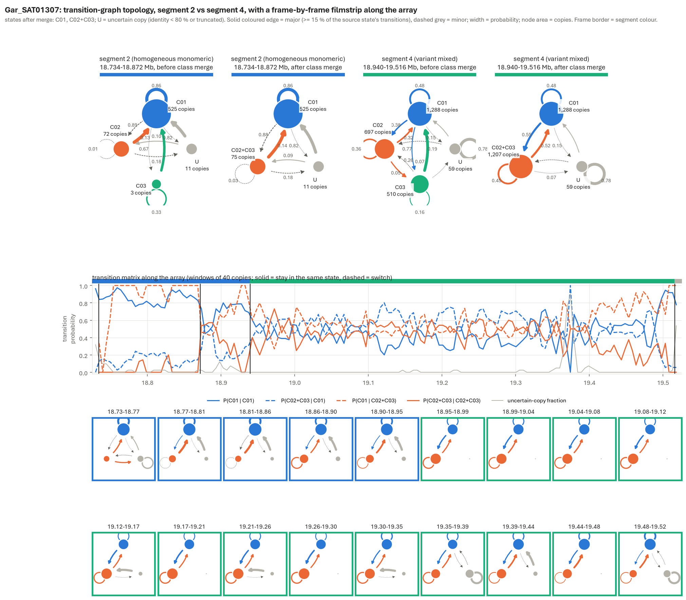
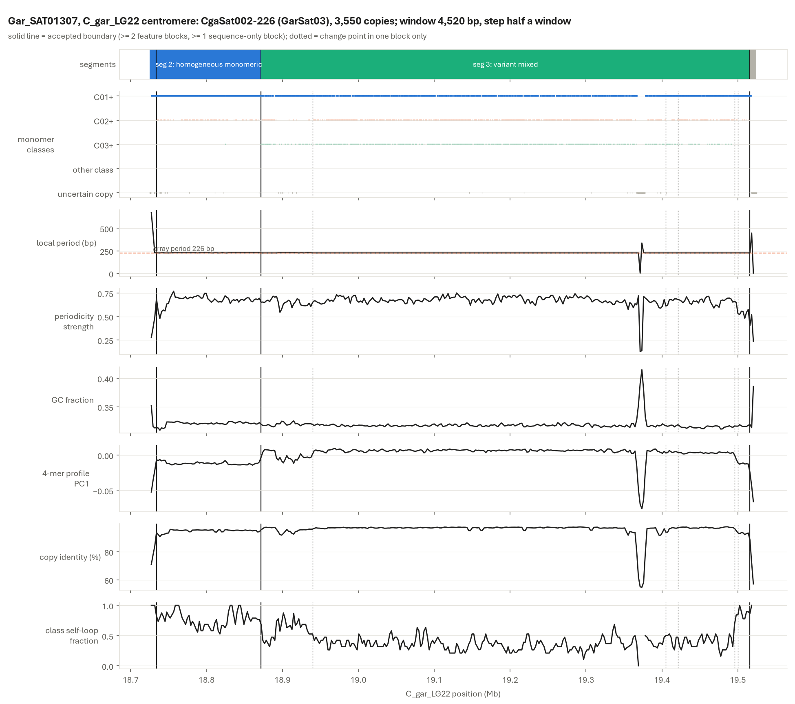
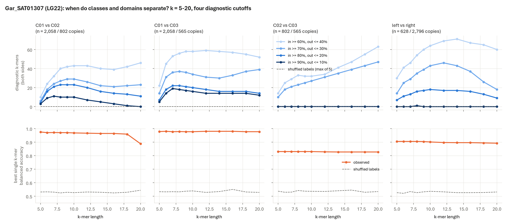
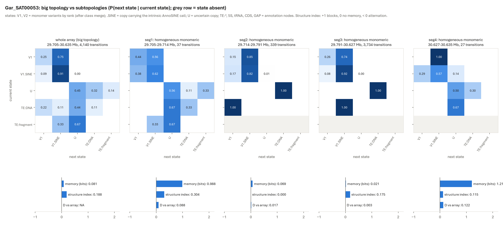

# SatChain

> **Experimental.** SatChain was built and tested on one genome, the F1 hybrid catfish *Clarias macrocephalus* × *C. gariepinus*
> (fClaHyb, two haplotypes, 55 chromosomes). Interfaces, file layouts and defaults may still change, and the scripts expect the input
> layout described below. Results are sequence-level annotations (evidence level L1). The largest satellite block of a chromosome is
> reported as a *putative* centromeric array, not as a proven centromere.

SatChain annotates satellite DNA by reading each array as an **ordered chain of monomer copies**. Each step relies on established
methods: k-mer recurrence against shuffled sequence (NTRprism idea), StringDecomposer, hidden Markov segmentation, and Miga-style monomer
transition graphs. SatChain combines them so that:

1. candidate tandem repeats come from a **genome-wide, annotation-free scan**, not from a fixed periodicity threshold;
2. **arrays and their boundaries are called on the copy chain** by a two-state hidden Markov model, not by "≥ N copies at ≥ X % identity" rules;
3. every call is **checked on the sequence** against a null, and **every threshold is swept** and reported as a range;
4. **topology** (which monomer variant follows which) is described per array and per segment, with annotations as nodes;
5. **lineages and families come last**, assigned per copy from k-mer profiles, without labels as input.

## Example: one centromeric array

The putative centromeric array of *C. gariepinus* LG22 (Gar_SAT01307, 800 kb, 3,550 copies, family CgaSat002-226):

How to read it:
- **Top:** transition graphs of two segments, before and after merging monomer classes that no k-mer separates (C02 and C03 here).
  Nodes are variants (area = copies) and edges show what follows what (width = probability). Solid edges are major (≥ 15 % of a node's
  transitions), dashed edges are minor.
  - The **blue part** is one dominant variant with isolated copies of the second.
  - The **green part** is two variants interleaved with no memory (every transition ≈ 0.5).
- **Middle:** each entry of the transition matrix along the array. Boundaries (vertical lines) are accepted only when two independent
  feature blocks agree, at least one of them from the sequence alone.
- **Bottom:** the same graph frame by frame along the array.

More views:

| | |
|---|---|
|  |  |
| Window features and segments along the array (composition, 4-mer profile, local period, identity, self-loop). The dip at 19.37 Mb is a Gypsy LTR insertion. | When do monomer classes separate? Near-fixed k-mers, k = 5–20, four cutoffs, shuffled-label null. C01 is a real variant; C02 and C03 are not. |

*Whole-array vs per-segment transition matrices of Gar_SAT00053 (LG01). The `V1.SINE` state marks copies carrying a per-monomer AnnoSINE
call, an annotation used as part of the node ("cross feature").*

## What changed on fClaHyb: before (threshold pipeline v4.5) vs SatChain (v4.6 draft)

| | v4.5 (thresholds) | SatChain | note |
|---|---|---|---|
| Satellite sequence, Gar / Mac | 18.57 / 14.33 Mb (+0.97 / 1.52 Mb rescued) | **18.67 / 14.58 Mb** satellite + 2.95 / 2.31 Mb gene arrays | gene arrays (5S, U1, U2, U6, tRNA, miR-430) now separated |
| New arrays outside every v4.5 array | – | **2,244 / 2,138 runs, 1.90 / 1.93 Mb** | mostly 7–39 bp minisatellites, which the old 40–1,000 bp lag scan never looked at |
| Centromeric families with a lineage | 11 (hand-picked seeds) | **166** (155 newly assigned) | copy-level k-mer clustering; no family split between lineages |
| Lineage classes | A, B | A, B, **centromere-associated minisatellite** (Mac) | the third class has its own short period (77 % of copies at < 70 bp) |
| Runs / intervals passing all QC gates | 4 % / 2 % of scan intervals | **90 % / 84 % of runs** | the same gates, computed on runs instead of diluted scan windows |
| "TE content" of satellite | EDTA overlap 17.2 / 12.3 Mb | **0.14–0.50 / 0.16–0.40 Mb TE insertions** | EDTA labels most satellites as TE; that label is now separated |
| Unit length of the top family | CgaSat001-232 (consensus) | **CgaSat001-216** (median real copy) | the old consensus carried 15 bp the copies lack |

## Genome-wide sweep

Every chromosome (1.86 Gb over both haplotypes) was tiled with 2-kb windows (lags 7–1,000 bp) and 10-kb windows (lags 1–5 kb). Each
window's 10-mer recurrence was compared with a base-shuffled copy of itself. Runtime was about 30 minutes on 3 cores.

| tier (null quantile) | candidate Mb, Gar / Mac | recall of validated runs | recall of v4.5 runs | new outside v4.5 arrays |
|---|---|---|---|---|
| p99 | 83 / 77 | 0.92 / 0.86 | 0.93 / 0.90 | 56 / 50 Mb (28 / 21 TE-overlapping) |
| **p99.9** | **41 / 37** | **0.91 / 0.86** | **0.92 / 0.89** | **14.3 / 11.6 Mb** |

New candidates are kept as arrays only with **≥ 3 consecutive copies**: 10-mer recurrence at p, p+L and p+2L above a dinucleotide-block
shuffle. This test and TRF agree independently. For 61–1,000 bp units, TRF supports 70–76 % of candidates the test calls arrays, and only
5–10 % of the duplicated pairs it rejects. New arrays beyond v4.5, Gar / Mac (non-TE + TE-overlapping):
7–39 bp 2.71 + 2.25 / 2.39 + 1.27 Mb; 40–60 bp 0.58 + 0.42 / 0.64 + 0.39 Mb; 61–1,000 bp 0.67 + 1.86 / 0.60 + 0.68 Mb.
New arrays with units > 1 kb were almost all tandem tRNA-gene clusters and one U6 cluster.

## Benchmarks and sensitivity (all tables in `benchmarks/`)

**Sequence-level tests**
- **The old threshold loses real satellite.** Tandem share of scan windows by lag-identity band, against random windows outside all arrays:
  0.25–0.30: 0 %; 0.30–0.32: 48 / 38 %; 0.32–0.34: 66 / 66 %; 0.34–0.36: 87 / 81 %; ≥ 0.40: 100 / 99 % (Gar / Mac). The fixed 0.34 cut
  was on a cliff (`threshold_band_test_*.tsv`).
- **HMM-only bases are tandem.** Their median 1-kb tandem signal is 0.157 / 0.116, against 0.000 for in-array background; 73 / 58 % sit
  above the background p90. Per-run check at p80 / p90 / p95: Gar adds 1.8 / 1.5 / 1.0 Mb and keeps 98–94 % of v4.5 bases
  (`hmm_vs_threshold_runs_*.tsv`).
- **The lineage split is stable and matches the old labels.** The K = 2 split is identical for k = 5, 6 and 7 (ARI 1.0), equals the old A/B
  labels for every labelled copy, and B copies are 5S-related (median 5S score 31.7 vs 0) (`lineage_clustering_sweep.tsv`).

**Sensitivity** (one parameter at a time around the default, compared with the default run)
- **Segmentation** (`sweep_segmentation_*.tsv`): segment profiles agree on 95–100 % of bases across all 12 alternative settings. The
  change-point penalty sets the resolution and its boundaries are nested: penalty 6 (18 Gar boundaries) ⊂ 3 (33) ⊂ 1.5 (70). They are
  used as three levels: big topology, subtopology, sub-subtopology.
- **Topology cutoffs** (`sweep_topology_*.tsv`): core/accessory edge roles change for ≤ 7 of ~300–460 edges. The intrinsic-annotation
  fraction (0.2–0.5) and copy scale (1.5–4 units) have no effect. The uniform-annotation cutoff is the sensitive one (0.95 vs 0.99).
- **HMM posterior cut:** 0.5 / 0.8 / 0.95 give 20.67 / 20.55 / 20.41 Mb (Gar).
- **Class merging:** C01 separates from C02 and C03 at every k from 5 to 20; C02 vs C03 never has a near-fixed k-mer
  (`class_merge_kmer_sweep_*.tsv`).
- **Gene arrays** (observed / expected for one gene per unit, cut 0.5 / 0.7 / 0.8): Gar 2.97 / 2.95 / 2.95 Mb.
- **TE layer** (intrinsic cut 0.2 / 0.3 / 0.5): TE insertions are 0.7–2.4 % of satellite sequence.
- **Interruptions between runs** (`interruptions_between_runs.tsv`; gaps ≤ 50 kb inside one array): TE-filled gaps total 4.69–4.82 Mb
  (Gar) and 5.80–6.34 Mb (Mac) over 9 filter settings. In Mac, most are a ~7.5-kb LTR element (EDTA TE_00003409, LTR/unknown) every
  ~12.5 kb in MacSat03 arrays; EDTA gives it the satellite's own label, so intrinsic labels are filtered per feature, not per label.
- **Second-order topology** (`second_order_sweep.tsv`; H1 − H2 against 50 chains simulated from each array's own first-order matrix,
  BH q per genome). At q < 0.05 and excess ≥ 0.05 bits, 13–25 % of long chains have order-2 structure: Gar 88 of 459 arrays with ≥ 50
  copies (2.43 Mb), 15 of 64 with ≥ 200; Mac 73 of 552 (0.99 Mb), 8 of 56. Results barely change between q 0.05 and 0.01. The effect-size
  floor is needed: without it, large arrays pass on tiny excess. Carriers are the centromeric lineage A/B families (GarSat03/04,
  MacSat03/06). The typical context is V1>V1:V1, i.e. variant blocks longer than a first-order chain makes. Synthetic checks: (AAB)n z = 377,
  i.i.d. z = −0.15. Chains under 50 copies are not interpretable.

## Pipeline

| step | script | what it does |
|---|---|---|
| 57 | `57_genome_tandem_scan.py` | genome-wide annotation-free k-mer recurrence scan (two window scales) |
| 58 | `58_scan_calibrate.py`, `58b_new_candidates.py`, `val58_new.py` | null quantiles, candidates, 3-copy chain test, TRF agreement |
| 03 | `03_monomer_copies.py` | monomer decomposition with StringDecomposer (iterative class libraries) |
| 53 (merge) | inside `53_array_segmentation.py` | merge monomer classes no near-fixed k-mer separates |
| 56 | `56_path_hmm.py`, `val56_signal.py`, `val56_runfilter.py` | copy-chain HMM arrays and runs; per-run sequence check |
| 53 / 53b / 53c | `53_array_segmentation.py`, `53b_topology_compare.py`, `53c_library_pool.py` | windows, change points, topology (memory, structure index, core/accessory), topology library |
| 55 | `55a_lineage_sample.py`, `55c_lineage_cluster.py`, `55d_family_lineage.py` | lineage per copy from k-mer profiles |
| 59 | `59_final_catalogue.py`, `59b_gene_arrays.py`, `59c_te_layer.py`, `59d_family_names.py`, `famnew.py` | catalogue, per-run gates, gene arrays, TE layer, names (species + Sat + rank + unit) |
| 59e | `59e_interruptions.py` | gaps between runs of one array: TE / missed TE / other annotation / unannotated (intrinsic EDTA labels filtered per feature) |
| 53b (order 2) | `53b_o2_summary.py` | second-order test summary with q / excess / chain-length sweep |
| 60 | `60a_tx_kmers.py` | family-specific k-mers for transcription tests in RNA-seq (in development) |
| plots / sweeps | `plot53_*.py`, `plot53b_units.py`, `plot_sweep.py`, `kmer_separation_sweep.py`, `sweep53_compare.py`, `sweep53b.py` | figures and sensitivity sweeps |

`workflow/run_satchain.sh` lists the commands in order. Edit the variables at its top.

## Inputs and dependencies

- **Genome:** FASTA + `.fai`, per haplotype.
- **Annotation folder per haplotype**, in the layout the scripts expect (see `docs/INPUTS.md`): EDTA TE annotation, barrnap rRNA, tRNAscan,
  Rfam, miRNA, LiftOn genes, GMATA SSRs, TRF calls, gaps.
- **Software:** Python ≥ 3.10 with numpy, matplotlib, pandas, openpyxl and edlib; StringDecomposer; BLAST+; samtools. For step 60, also
  sra-tools and Jellyfish (`kmer-jellyfish`). See `environment.yml`.

## Status and limits

Experimental, single-genome. Not yet done: read-level copy-number support, transcription test (step 60, running), comparison of
order-2 topologies between arrays (Miga-style second-order graph). The second-order test itself is in (step 53b).

## Methods paragraph

See `docs/METHODS.md`.

## License

MIT License (see `LICENSE`).
