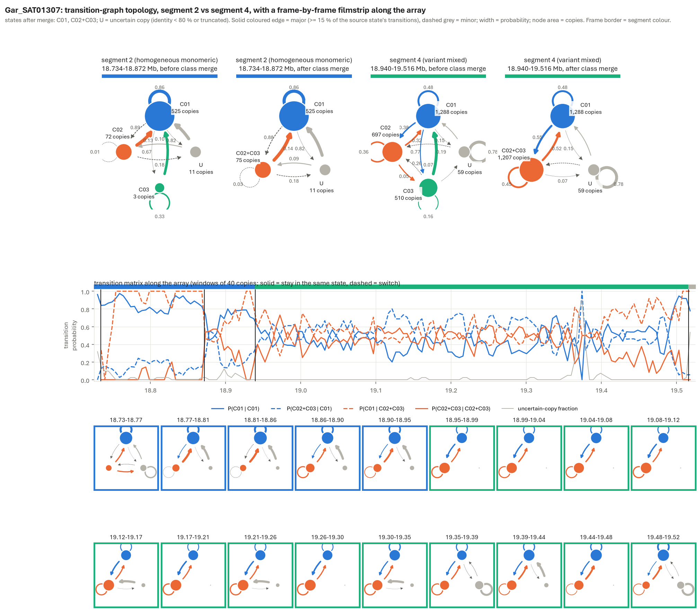
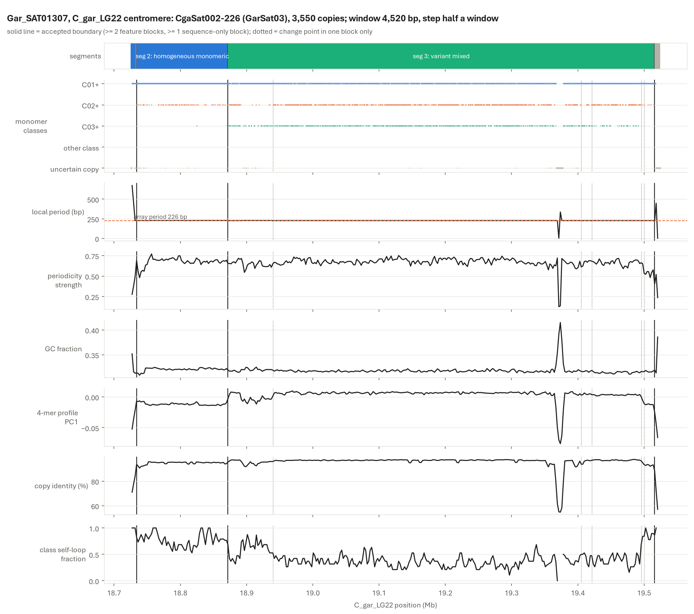
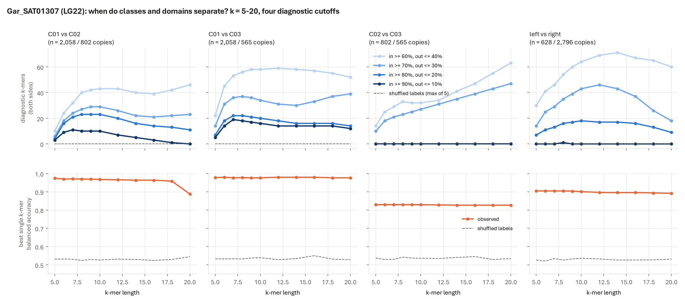
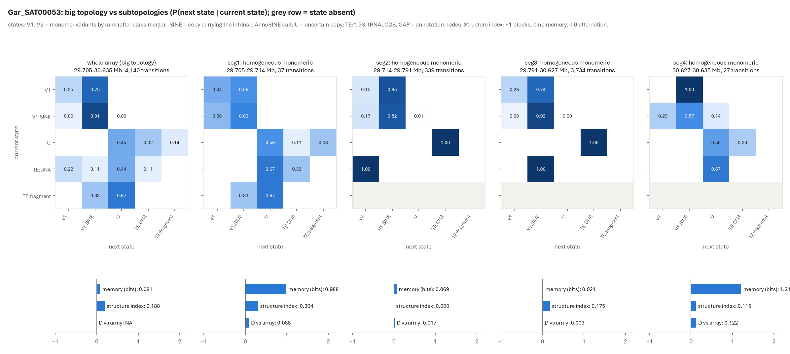

# SatChain

> **Experimental.** SatChain was built and tested on one genome, the F1 hybrid catfish *Clarias macrocephalus* × *C. gariepinus*
> (fClaHyb, two haplotypes, 55 chromosomes). Interfaces, file layouts and defaults may still change, and the scripts expect the input
> layout described below. Results are sequence-level annotations (evidence level L1). The largest satellite block of a chromosome is
> reported as a *putative* centromeric array, not as a proven centromere.

SatChain annotates satellite DNA by reading each array as an **ordered chain of monomer copies**. Each step relies on established
methods: k-mer recurrence against shuffled sequence (NTRprism idea), StringDecomposer, hidden Markov segmentation, and Miga-style monomer
transition graphs. SatChain combines them so that:

1. candidate tandem repeats come from a **genome-wide, annotation-free scan**, not from a fixed periodicity threshold;
2. **arrays and their boundaries are called on the copy chain** by a two-state hidden Markov model, not by "≥ N copies at ≥ X % identity" rules;
3. every call is **checked on the sequence** against a null, and **every threshold is swept** and reported as a range;
4. **topology** (which monomer variant follows which) is described per array and per segment, with annotations as nodes;
5. **sequence clusters and families come last**, assigned per copy from k-mer profiles, without labels as input. A cluster is a partition
   of monomers by composition, not an evolutionary lineage (the word "lineage" was dropped on 2026-11-01); origin statements such as
   "5S rDNA-derived" or "RTE-interleaved" are made per family from homology evidence.

## Example: one centromeric array

The putative centromeric array of *C. gariepinus* LG22 (Gar_SAT01307, 800 kb, 3,550 copies, family CgaSat002-226):

How to read it:
- **Top:** transition graphs of two segments, before and after merging monomer classes that no k-mer separates (C02 and C03 here).
  Nodes are variants (area = copies) and edges show what follows what (width = probability). Solid edges are major (≥ 15 % of a node's
  transitions), dashed edges are minor.
  - The **blue part** is one dominant variant with isolated copies of the second.
  - The **green part** is two variants interleaved with no memory (every transition ≈ 0.5).
- **Middle:** each entry of the transition matrix along the array. Boundaries (vertical lines) are accepted only when two independent
  feature blocks agree, at least one of them from the sequence alone.
- **Bottom:** the same graph frame by frame along the array.

More views:

| | |
|---|---|
|  |  |
| Window features and segments along the array (composition, 4-mer profile, local period, identity, self-loop). The dip at 19.37 Mb is a Gypsy LTR insertion. | When do monomer classes separate? Near-fixed k-mers, k = 5–20, four cutoffs, shuffled-label null. C01 is a real variant; C02 and C03 are not. |

*Whole-array vs per-segment transition matrices of Gar_SAT00053 (LG01). The `V1.SINE` state marks copies carrying a per-monomer AnnoSINE
call, an annotation used as part of the node ("cross feature").*

## What changed on fClaHyb: before (threshold pipeline v4.5) vs SatChain (v4.7, 2026-11-01)

Every number below is computed by `benchmarks/regenerate_numbers.py` from the tables of the run folder (`benchmarks/NUMBERS_2026-11-01.tsv`
names the source table of each). The v4.6 draft numbers quoted before 2026-11-01 were withdrawn after the code audit
(`docs/CHANGELOG_2026-11-01.md`): StringDecomposer batch duplicates, a 5S rDNA array counted as satellite, overlapping runs summed,
gene arrays inside the tiers and the clustering, a vacuous identity gate and an unreproducible band test.

| | v4.5 (thresholds) | SatChain v4.7 | note |
|---|---|---|---|
| Satellite sequence, Gar / Mac (all satellite families) | 18.57 / 14.33 Mb | **18.33 / 12.63 Mb** satellite + 2.57 / 4.84 Mb gene arrays | gene arrays (5S, U1, U2, U6, tRNA, miR-430) separated before tiers; MacSat06 (2.6 Mb) is the *C. macrocephalus* 5S rDNA array (74 % of its units carry an annotated 5S gene) |
| of which units ≥ 100 bp / 7–99 bp | – | 13.52 + 4.81 / 6.09 + 6.54 Mb | the runs-of-record 100-bp rule is now the catalogue's `unit_class` |
| New runs outside every v4.5 array | – | **2,190 / 2,076 runs, 1.77 / 1.68 Mb** | mostly 7–39 bp minisatellites; the Mac runs are carried from the v4.6 draft (their 03 table was lost; column `carried_from`) |
| Runs passing the three QC gates | 4 % / 2 % of scan intervals | **87 % / 80 % of runs** (sweep 61–97 % / 54–95 %) | G2 is now a real identity cut (≥ 85 %; 289 / 567 runs fail); `59_gates_sweep_*.tsv` |
| Sequence clusters of centromeric monomers | lineages A, B | **K = 2** (fallback: no K ≥ 3 is stable across k or restarts, `55_K_choice.tsv`): C2.1 = every family but one, C2.2 = GarSat04 | the former "lineage B in both haplotypes" was GarSat04 plus the 5S gene arrays GarSat49 / MacSat06; without them *C. macrocephalus* has one cluster |
| TE insertions inside runs | EDTA overlap 17.2 / 12.3 Mb | **0.7–2.6 / 0.9–2.4 %** of run bp (v4.6 carry rule) or 5.5–7.7 / 6.3–8.5 % (feature ≥ 50 % of the copy) | EDTA labels most satellites as TE; both carry rules are shipped (`59c_te_*.tsv`, `cat59_minrule/`) |
| Overlapping runs | summed | resolved (26 / 6 merged or trimmed) | same family merged, different families trimmed |
| Unit length of the top family | CgaSat001-232 (consensus) | **CgaSat001-216** (median real copy) | the old consensus carried 15 bp the copies lack |

## Genome-wide sweep

Every chromosome (1.86 Gb over both haplotypes) was tiled with 2-kb windows (lags 2–1,000 bp; lags < 7 bp left to microsatellite
callers) and 10-kb windows (lags 1–5 kb). Each window's forward-strand 10-mer recurrence was compared with a base-shuffled copy of itself.
Runtime was about 30 minutes on 3 cores.

| tier (null quantile) | candidate Mb (union), Gar | recall of validated runs | recall of v4.5 runs | new outside v4.5 arrays (union) |
|---|---|---|---|---|
| p99 | 62.5 | 0.92 | 0.93 | 28.3 Mb |
| **p99.9** | **31.9** | **0.90** | **0.91** | **6.4 Mb** (TE-derived 3.4) |

(2026-11-01 rerun with the null taken over windows whose best lag is ≥ 7 bp, `cal58_Gar_rerun/58_validation.tsv`; the earlier
41 / 37 Mb came from a null that was 66–72 % zeros. *C. macrocephalus* was not rerun at this step.)

New candidates are kept as arrays with **≥ 3 consecutive copies**: 10-mer recurrence at p, p+L and p+2L above a dinucleotide-block
shuffle; 7–39 bp candidates are also kept when compatible TRF calls cover ≥ 50 % of them (`58c_new_arrays_02format.py`, both routes
reported in `kept_by`). The tier cut-offs and the tested length are swept in `58b_tier_sweep.tsv` (Gar: 2,732–3,121 chain-supported
candidates at chain cut 0.02–0.005; the tested length 10–40 kb moves ≤ 2 candidates). TRF *coverage* of the 7–39 bp candidates is low
(median 0.23), so the TRF route keeps 61 candidates by coverage against 876 by the old ≥ 1-bp overlap.

## Benchmarks and sensitivity (all tables in `benchmarks/`)

**Sequence-level tests**
- **The old threshold loses real satellite** (`threshold_band_test_*_summary.tsv`, script `benchmark_band_test.py`, null = random 10-kb
  windows outside every step-02 interval, catalogue run and TRF call): share of scan windows that are tandem above the null p95, by
  lag-identity band, Gar / Mac: 0.25–0.30: 17 / 10 %; 0.30–0.32: 88 / 70 %; 0.32–0.34: 99 / 94 %; ≥ 0.34: 99–100 %; random windows 5 / 5 %.
  The fixed 0.34 cut was on a cliff.
- **Per-run check** (`val56_benchmark_*.tsv`; k-mer excess at any lag vs the p90 of windows outside all candidate intervals, where only
  0.5 % of bins are zero): at q0.8 / 0.9 / 0.95 Gar keeps 5,109 / 5,055 / 4,696 of 5,342 HMM runs and adds 3.6 / 3.6 / 3.4 Mb beyond v4.5
  while keeping 94 % of the v4.5 bases; Mac keeps 4,223 / 3,998 / 3,517 of 4,742, adds 2.7 / 2.5 / 2.3 Mb, keeps 94–93 %.
- **Sequence clusters** (`55_K_choice.tsv`, `55_cluster_summary.tsv`, `55_haplotype_stability.tsv`): 30,917 confident copies sampled from
  the candidate centromeric runs of both haplotypes (gene arrays excluded). K = 2 is the only partition stable across k = 5–7 and across
  restarts (ARI 1.0 / 1.0, silhouette 0.39); K = 3 gives ARI 0.38 / 0.52, K = 4–8 0.61–0.75 / 0.44–0.72. At K = 2, C2.2 holds the 5,336
  GarSat04 copies and nothing else; C2.1 holds all 17,665 Mac copies and the other Gar families. No sampled copy has an annotated 5S gene
  (55b): the 5S origin of GarSat04 is a homology statement, not a cluster property.

**Sensitivity** (one parameter at a time around the default, compared with the default run)
- **HMM posterior cut:** 0.5 / 0.8 / 0.95 give 22.59 / 22.39 / 22.22 Mb (Gar) and 17.66 / 17.36 / 17.23 Mb (Mac), one model per haplotype
  fitted on the existing and new tables together (`56_summary.tsv`, `56_hmm_params.tsv`).
- **Gates** (`59_gates_sweep_*.tsv`; G1 3 / 5 / 8 GC points, G2 80 / 85 / 90 % identity, G3 band 0.3–0.7 to 0.4–0.6): 61–97 % (Gar) and
  54–95 % (Mac) of runs pass all three; G2 at 90 % is the sensitive setting.
- **Gene arrays** (bp ratio cut 0.5 / 0.7 / 0.8 at unit share ≥ 0.5, `59b_gene_arrays_*_sweep.tsv`): Gar 2.60 / 2.57 / 2.57 Mb;
  Mac 5.35 / 4.84 / 2.25 Mb. The Mac drop at 0.8 is MacSat06 (ratio 0.74, unit share 0.74): it is a gene array by both criteria at the
  default cut and the sweep shows where the call would flip.
- **TE layer** (intrinsic cut 0.2 / 0.3 / 0.5, two carry rules): see the table above; `missed known-TE insertions` (step 54) add
  0.09 / 0.15 Mb.
- **Interruptions between consecutive same-family runs** (`59e_interruptions_*.tsv`, `59e_sweep_*.tsv`; gap ≤ 50 kb, class cut
  0.3 / 0.5 / 0.7 × intrinsic cut 0.2 / 0.3 / 0.5 × max gap 10 / 20 / 50 kb): TE-filled interruptions 4.69 Mb in 693 gaps (Gar; sweep
  3.5–5.8 Mb) and 5.84 Mb in 816 (Mac; 2.4–10.0 Mb); other classes split into exon/CDS, intron, ncRNA and SSR (Gar intron 1.28 Mb,
  unannotated 1.01 Mb; Mac intron 5.61, unannotated 4.16 Mb). 33 / 62 interruptions link runs of different v4.5 intervals. In Mac, most
  TE interruptions are a ~7.5-kb LTR element (LTR/unknown) between MacSat03 runs; EDTA gives it the satellite's own label, so intrinsic
  labels are filtered per feature, not per label.
- **Segmentation** (`53_summary.tsv`, run mode on the runs of record): of 2,747 / 2,855 Gar / Mac existing satellite runs, 1,019 / 1,223
  are too short for any window and 1,388 / 2,227 use copy-indexed windows; 32 / 21 runs have more than one segment. Composition and
  4-mer features now count as one block: 8 Gar boundaries (18 % of the old rule's acceptances) rested on those two alone and are reported
  as candidates. The 2026-10 sweeps on 30 hand-picked step-02 intervals (`sweep_segmentation_*.tsv`, `sweep_topology_*.tsv`) describe
  those intervals, not the runs of record, and are kept for the record only.
- **Second-order topology** (`53b_o2_sweep.tsv`; H1 − H2 against 100 chains simulated from each run's own first-order matrix, BH within
  each reported set of runs with ≥ 20 / 50 / 100 / 200 variant-only transitions, excess ≥ 0 / 0.05 / 0.1 bits): at q < 0.05 and
  excess ≥ 0.05 bits, Gar 43 of 167 runs with ≥ 50 variant transitions (1.15 Mb) and 6 of 31 with ≥ 200; Mac 34 of 143 (1.04 Mb) and
  3 of 15. At q < 0.01 the counts fall to 34 / 23 (≥ 50), so the q cut matters at the lower chain lengths (not "barely"). The units are
  runs, not arrays; p is the normal tail of the simulation z (stated in the table). Synthetic checks: (AAB)n z = 377, i.i.d. z = −0.15.
- **Class merging:** C01 separates from C02 and C03 at every k from 5 to 20; C02 vs C03 never has a near-fixed k-mer
  (`class_merge_kmer_sweep_*.tsv`, one array; `kmer_separation_sweep.py --k-report`).

## Pipeline

| step | script | what it does |
|---|---|---|
| 57 | `57_genome_tandem_scan.py` | genome-wide annotation-free k-mer recurrence scan (two window scales) |
| 58 | `58_scan_calibrate.py`, `58b_new_candidates.py`, `val58_new.py` | null quantiles, candidates, 3-copy chain test, TRF agreement |
| 03 | `03_monomer_copies.py` | monomer decomposition with StringDecomposer (iterative class libraries) |
| 53 (merge) | inside `53_array_segmentation.py` | merge monomer classes no near-fixed k-mer separates |
| 56 | `56_path_hmm.py`, `val56_signal.py`, `val56_runfilter.py` | copy-chain HMM arrays and runs; per-run sequence check |
| 53 / 53b / 53c | `53_array_segmentation.py`, `53b_topology_compare.py`, `53c_library_pool.py` | windows, change points, topology (memory, structure index, core/accessory), topology library |
| 55 | `55a_cluster_sample.py`, `55b_gene_overlap.py`, `55c_cluster_kmer.py`, `55d_family_cluster.py`, `59f_apply_clusters.py` | sequence clusters of satellite monomers from k-mer profiles (K by a stated rule, content-based names), written back into the catalogue |
| 59 | `59_final_catalogue.py`, `59b_gene_arrays.py`, `59c_te_layer.py`, `59d_family_names.py`, `famnew.py` | catalogue with overlaps resolved, per-run gates (+ sweep), gene arrays called before tiers, TE layer, names (species + Sat + rank + unit) |
| 59e | `59e_interruptions.py` | interruptions between consecutive same-family runs: TE / missed TE / other:exon_CDS, intron, ncRNA, SSR / unannotated (intrinsic EDTA labels filtered per feature; sweep) |
| 53b (order 2) | `53b_o2_summary.py` | second-order test summary with q / excess / chain-length sweep |
| 58c / 03b | `58c_new_arrays_02format.py`, `03b_dedup_copies.py` | kept candidates in 02 format (chain OR TRF-cover route, tier column); removal of StringDecomposer batch duplicates from older 03 tables |
| 60 | `60a_tx_kmers.py` | family-specific k-mers for transcription tests in RNA-seq (in development) |
| 61–65 | `chains.py`, `61_unit_boundaries.py`, `61b_jsd_boundaries.py`, `62_hor_detect.py`, `63_expansion_tracks.py`, `64_object_profiles.py`, `65_hor_mining.py` | array definition on chains of runs (one chain builder), base-pair boundaries, HOR detection with nulls and FDR, expansion tracks, object profiles; exploratory until their `--sweep` tables are on disk (`docs/STEP_METHOD.md` section 8) |
| benchmarks | `benchmark_band_test.py`, `benchmarks/regenerate_numbers.py` | the band test with its null, and every number of this README from the tables |
| plots / sweeps | `plot53_*.py`, `plot53b_units.py`, `plot63_array.py`, `plot_sweep.py`, `kmer_separation_sweep.py`, `sweep53_compare.py`, `sweep53b.py` | figures (450 dpi + PDF) and sensitivity sweeps |

`workflow/run_satchain.sh` lists the commands in order (sweep → copies → dedup → HMM → per-run check → catalogue → TE layer → names →
interruptions → clusters written back → topology → array definition). Edit the variables at its top. `satchain/satpaths.py` resolves the
annotation layout; `tests/test_gaps_jsd.py` runs the synthetic tests of gaps, chains, 61, 61b, 62, 63, 64 and 65.

## Inputs and dependencies

- **Genome:** FASTA + `.fai`, per haplotype.
- **Annotation folder per haplotype**, in the layout the scripts expect (see `docs/INPUTS.md`): EDTA TE annotation, barrnap rRNA, tRNAscan,
  Rfam, miRNA, LiftOn genes, GMATA SSRs, TRF calls, gaps.
- **Software:** Python ≥ 3.10 with numpy, matplotlib, pandas, openpyxl and edlib; StringDecomposer; BLAST+; samtools. For step 60, also
  sra-tools and Jellyfish (`kmer-jellyfish`). See `environment.yml`.

## Status and limits

Experimental, single-genome. Not yet done: read-level copy-number support, transcription test (step 60, running), comparison of
order-2 topologies between arrays (Miga-style second-order graph). The second-order test itself is in (step 53b). Known limits of the
v4.7 run: the *C. macrocephalus* new-candidate runs are carried from the v4.6 draft (their 03 table was lost before the dedup; rerun
58c → 03 to replace them); the 58 calibration with the lag ≥ 7 null was rerun for *C. gariepinus* only; steps 61–65 have no genome-wide
output on disk yet.

## Methods paragraph

See `docs/METHODS.md`.

## License

MIT License (see `LICENSE`).
